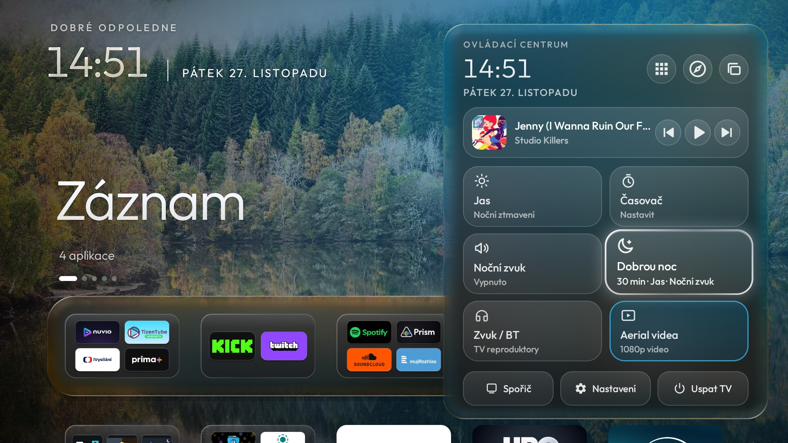
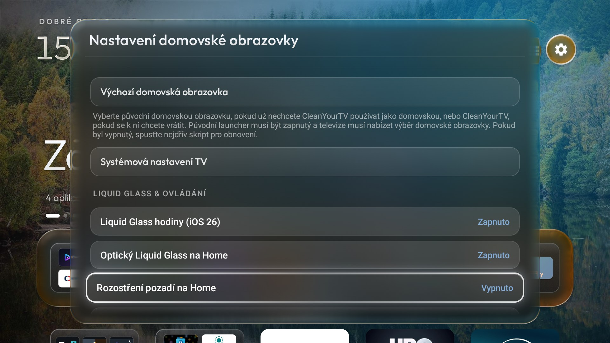
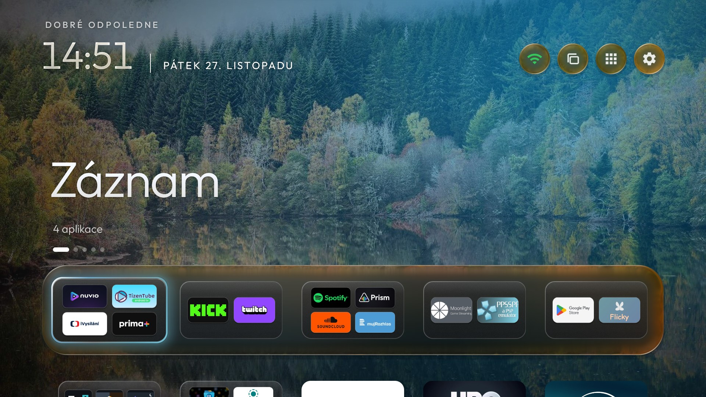
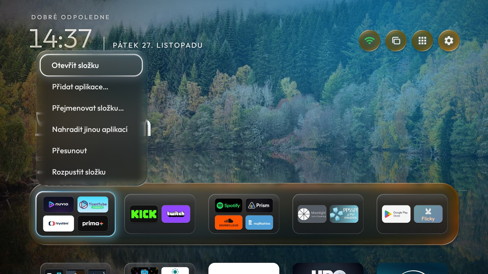
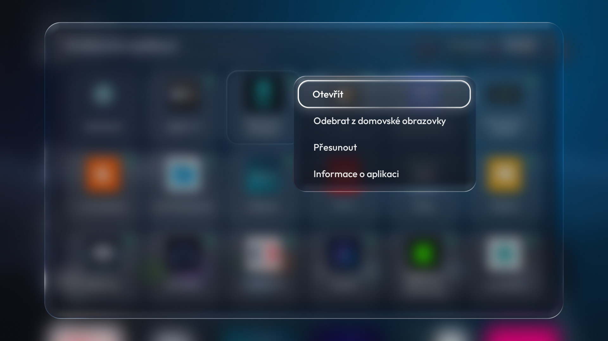
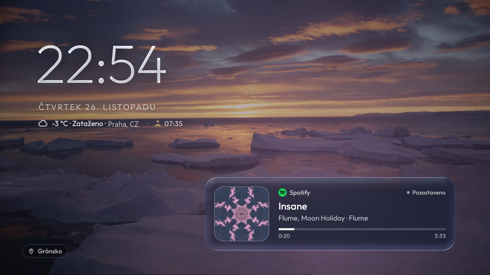

# Matcher — Liquid Glass Android TV / Google TV Experience

**Matcher** is an ad-free, Apple tvOS 26–inspired Liquid Glass launcher, modular add-on suite, and automated deployment kit for **Android TV / Google TV** (Android 13/14+, built on top of [CleanYourTV](https://github.com/Gathin23/cleanyourtv)).

Designed to run smoothly even on 2 GB RAM streaming boxes (reference device: **Xiaomi TV Box S 3rd Gen**, `MiTV-AFMU0`, Android 14 / SDK 34), Matcher turns Google TV into a fast, clutter-free living-room interface with optical frosted glass refraction, system-wide overlays, smart-home controls, and zero sponsored home-screen ads.

> **Documentation hub:**
> - **Visual Gallery (`v1.1.2` — 4 new Sharp Home shots + 43 `v1.1.1` full-UI shots):** [`docs/GALLERY.md`](docs/GALLERY.md)
> - **Users (Czech guide):** [`docs/README-cs.md`](docs/README-cs.md)
> - **Contributors & Translators:** [`CONTRIBUTING.md`](CONTRIBUTING.md)
> - **AI Coding Agents:** [`AGENTS.md`](AGENTS.md) and [`SKILL.md`](SKILL.md)

---

## Visual Showcase (`v1.1.2`)

[-38BDF8?style=flat-square)](docs/GALLERY.md)

| New in `v1.1.2` — Sharp Home + Crisp `960×540` Control Center | New in `v1.1.2` — Live *Home Backdrop Blur* Toggle |
|---|---|
|  |  |

| Home Screen (`v1.1.2` Crisp Dock & Top Pills) | Tile Context Menu Over 100% Sharp Home |
|---|---|
|  |  |

| App Library + Material 3 Expressive Nested Blur | 4K Aerial Ambient Screensaver |
|---|---|
|  |  |

👉 **[Explore the full `v1.1.2` Photo Gallery (all 47 screens, submenus, quick bars & add-ons) → `docs/GALLERY.md`](docs/GALLERY.md)**

---

## Highlights & Features

### 1. Real-Time Liquid Glass 2.0 & Material 3 Expressive Engine
- **4-Layer Optical Refraction:** Custom Android 13/14 AGSL `RuntimeShader` (`ExpressiveGlass`) renders dual-profile curved meniscus refraction with 5-tap corner-weighted RGB prism dispersion, dark-TV highlight protection, directional Fresnel speculars, and interactive **Dock glass ripple** on tile focus changes. Each UI tier samples accurately from what sits beneath it: Wallpaper/HeroArt (Layer 0) → Dock, Top Pills & Clock (Layer 1) → Modals, Overlays & Add-ons (Layer 2) → Nested Context Menus & Pickers (Layer 3 via `nestedRefraction`).
- **Optional Sharp Home Mode (`v1.1.2`):** Toggle **Home backdrop blur** off in *Launcher Settings* to keep the Home screen 100% razor-sharp (0% dim) behind floating modals and menus. Every floating panel automatically switches to its own **GPU `RenderNode`-cached per-panel frosted interior blur** (`uInteriorFill = 1.0f` — locked 60 FPS during D-pad navigation) paired with **untouched crisp `960×540` `uSharp` optical rim refraction** across modals, context menus, Dock, top-right circular pills, beveled clock, and all 8 glass add-ons (with synchronous Frame-0 blur via `EXTRA_OVER_SHARP_BACKDROP`).
- **60/120 FPS Material 3 Expressive Nested Blur:** Opening a context menu or picker over any modal smoothly crossfades the parent panel into a hardware-cached 2-`RenderNode` GPU Skia Gaussian + `BACKDROP_AGSL` veil (vibrancy, wallpaper-derived tonal tint, IGN anti-banding grain) rasterized **once** into a compositing layer while keeping the parent's outer Liquid Glass rim razor-crisp.
- **3D Tactile Tile Physics & GPU Pre-Warming:** Spring-damped 3D tile tilt, subtle living focus sway, tilt-coupled specular sheen (`TileSheenDrawable`), instant animation freeze on app launch (`prepareForAppLaunch`), and eager GPU `prepareToDraw()` uploads across wallpapers, hero art, and clock maps.
- **Smart Context Adaptation:** Automatically switches to smooth frosted glass over external video/DRM apps (Netflix, YouTube, Disney+, etc.) so Home wallpaper colors never leak onto live playback.
- **Optional iOS 26 Beveled Clock (`LiquidClockView`):** Toggleable in *Settings → Liquid Glass clock*; defaults to crisp luminous typography.
- **Living Fresnel Focus Ring:** Spring-damped wobbly glass focus highlight that dynamically adapts to tile/app colors.

### 2. Apple tvOS-Style System Overlays (Accessible Over Any App)
- **Control Center** *(Hold Home ~0.55 s or Gear button)*: Media controls, Brightness, Sleep Timer, Quiet Hours, Good Night scene, Bluetooth / Headphones, Aerial Video Screensaver, Home Assistant smart-home & live camera grid, and direct jumps to App Library, Discover, Recents, Settings, and Standby.
- **App Library** *(Apps key)*: Full sortable grid of all installed apps, keeping the Home screen clean and minimal.
- **App Switcher / Recents** *(Hold Back ~0.5 s)*: Horizontal card carousel with swipe/OK app switching and force-stop management.
- **Folders** *(Hold OK on any tile → Add to folder)*: Multi-app glass folders with instant *Add apps*, *Rename*, *Reorder*, *Move to another folder*, and *Dissolve*.
- **Media Mini-Player** *(Spinning Vinyl disc in top bar)*: Multi-session switcher, album art, live scrubbable seek bar, and zero-flicker opening.
- **Ambient & 4K HEVC Aerial Video Screensaver:** Apple TV 4K HEVC Aerial streams (with automatic 1080p SDR fallback), favorite loop pinning (`★`), live time/date, Open-Meteo local weather + sunrise/sunset, Now Playing card, optional OLED pixel drift, and one-press launch.

### 3. Discover, Smart Home, Live Camera PiP, Photos & Phone QR Setup
- **Discover Overlay** *(Compass icon in Control Center)*:
  - **Continue Watching:** Reads Android TV Watch Next & preview channels (with 1-click local ADB `READ_TV_LISTINGS` grant right from the TV).
  - **Unsponsored Trending Picks:** TMDB + Trakt + Plex filtered to your installed apps, with region selector (`CZ/SK/DE/GB/US`), animation filter, and optional direct `nuvio://tmdb/...` deep-linking.
- **Configure From Your Phone via QR Code:** Spins up an ephemeral local LAN web UI with a scannable QR code on TV so you can paste TMDB, Trakt, Plex, Home Assistant, and Immich credentials from your phone instead of typing on a TV remote. The server shuts down immediately when the dialog closes.
- **Home Assistant Smart Home & Live Camera PiP (`HaCameraOverlay`):** Fast toggle tiles for lights, switches, and scenes plus floating smoked-glass live PiP previews for `camera.*` entities directly from Control Center over any app or Home.
- **Immich Photo Sync:** Periodically syncs a chosen album from your self-hosted Immich server for wallpapers/screensaver.

### 4. Ergonomics, Safety & Recovery
- **Three-Level Remote Remapping (`HomeKeyService` / `InputKeyService`):** Separate Tap, Double-Tap (`double:`), and Long-Press (`hold:`, ~0.5 s) actions for every shortcut button (zero added tap delay on keys without `double:`), support for `action:<intent>` vendor shortcuts (e.g. `action:android.settings.DISPLAY_SETTINGS` for TCL picture settings), automatic **Gamepad Passthrough** for Moonlight / game streaming, and `stock_home_redirect` recheck for TVs where stock Google TV launcher cannot be disabled.
- **Soft UI Click Sounds, Auto-Fading Captions & Air-Mouse / Pointer Support** across every screen, popup, and dialog (plus sRGB wallpaper decoding for zero per-frame GPU color conversion on Mali/Android TV).
- **Crash-Loop Recovery Watchdog** (`CrashWatchdog`) & **1-Click Stock Launcher Restore** via loopback ADB (`LocalAdbClient`) respecting Android 14 safe restore ordering.

### 5. Modular Glass Add-ons (8 Included by Default, 40+ Available Upstream)
All 8 default add-ons are localized in English & Czech and share [`GlassKit.java`](patches/addons/brightness/app/src/main/java/io/github/maxhayim/brightness/GlassKit.java) (`Theme.GlassOverlay` + Liquid Glass 2.0 AGSL + 2-`RenderNode` Material 3 Expressive nested blur + living Fresnel focus ring):
1. **Brightness** — Dim screen below TV hardware minimum + warm night filter + floating quick bar.
2. **Sleep Timer** — 15–120 min timer, weekly wake/sleep schedule, exclusion dates, HDMI-CEC standby + quick bar.
3. **Headphones** — Battery level + auto-pause & mute TV speakers when Bluetooth headphones disconnect.
4. **Bluetooth Connect** — 1-click connect/disconnect for paired BT audio devices.
5. **Quiet Hours** — Scheduled night-time volume cap.
6. **Weather** — 3-day Open-Meteo forecast & air quality index.
7. **World Clock** — Up to 6 world clocks + optional screensaver.
8. **Capacity Stats** — Live RAM and storage breakdown.

> **Fully Modular — Add or Remove Anything You Want:** You do **not** have to install all 8 add-ons. Pass `-SkipAddons` to `apply-setup.ps1`, hide/uninstall any add-on you don't need, or pick **any of the 40+ community add-ons** from [`Gathin23/cleanyourtv/tree/main/addons`](https://github.com/Gathin23/cleanyourtv/tree/main/addons) (such as **Ad Blocking** for Pi-hole/AdGuard Home, **TV Hub** IPTV/HDHomeRun, **Frigate Glance**, **Game Day**, **Remote Access**, **Scoreboard**, **Files card**, **Floating Clock**, **Winter Cabin**, **Koi Pond**, **Neon Dream**, **News screensaver**, etc.). Any newly added add-on can be styled to match Matcher's Liquid Glass 2.0 aesthetic automatically using `GlassKit.java` — see [`SKILL.md`](SKILL.md#playbook-4--adding-visually-matching-glasskit-or-removing-modular-add-ons).

---

## Languages & Translations

| Component | Languages Included | Notes |
|---|---|---|
| **Launcher (`com.gathin.tvhome`)** | **31 locales** from upstream + complete **English (`values`)** and **Czech (`values-cs`)** for all Matcher features | All other 29 locales automatically fall back to English for Matcher-specific strings |
| **8 Modular Add-ons** | **English (`values`)** + **Czech (`values-cs`)** (+ partial upstream IT/DE/FR/ES/PT/RU/ZH-TW/KO/TR) | Adding a new language takes ~5 minutes — see [`CONTRIBUTING.md`](CONTRIBUTING.md#adding-or-improving-translations) |

---

## How Matcher Works & Where the Rest of the Source Lives

Matcher is packaged as an **overlay patch kit** built on top of upstream [**`Gathin23/cleanyourtv`**](https://github.com/Gathin23/cleanyourtv) (verified against CleanYourTV 3.6+, commit [`be60870`](https://github.com/Gathin23/cleanyourtv/commit/be6087056a1c7d4f08f3f1cc778d92374d86ef27)). That is why `patches/` contains only our new and modified files — Gradle build scripts, base launcher classes, add-on projects, themes, and 500+ TV profiles live upstream and are fetched automatically by [`apply-setup.ps1`](apply-setup.ps1).

| What you are looking for | Where it lives |
|---|---|
| **Base launcher project & Gradle build (`build.gradle`, `gradlew`, `build-and-install.*`)** | [`Gathin23/cleanyourtv/tree/main/launcher`](https://github.com/Gathin23/cleanyourtv/tree/main/launcher) |
| **All modular add-on source repos (8 matched by default + 32+ more upstream)** | [`Gathin23/cleanyourtv/tree/main/addons`](https://github.com/Gathin23/cleanyourtv/tree/main/addons) |
| **33+ ready-made themes** | [`Gathin23/cleanyourtv/tree/main/themes`](https://github.com/Gathin23/cleanyourtv/tree/main/themes) |
| **504+ TV / Box device profiles & debloat lists** | [`Gathin23/cleanyourtv/tree/main/docs/devices`](https://github.com/Gathin23/cleanyourtv/tree/main/docs/devices) & [`examples/`](https://github.com/Gathin23/cleanyourtv/tree/main/examples) |
| **Remote scancode / keycode guide** | [`Gathin23/cleanyourtv/blob/main/docs/REMOTE.md`](https://github.com/Gathin23/cleanyourtv/blob/main/docs/REMOTE.md) |
| **Safety rules, config switches & troubleshooting** | [`DOS-AND-DONTS.md`](https://github.com/Gathin23/cleanyourtv/blob/main/docs/DOS-AND-DONTS.md), [`switches.md`](https://github.com/Gathin23/cleanyourtv/blob/main/docs/switches.md), [`TROUBLESHOOTING.md`](https://github.com/Gathin23/cleanyourtv/blob/main/docs/TROUBLESHOOTING.md) |
| **Matcher's Liquid Glass 2.0, Control Center, Folders, Discover, Camera PiP & add-on overrides** | [`patches/`](patches/) in this repository (applied automatically by `apply-setup.ps1`) |

> **Reproducible builds:** `apply-setup.ps1` pins the verified upstream commit (`be6087056a1c7d4f08f3f1cc778d92374d86ef27`) by default so future upstream refactors will not break your build. To test against the latest upstream `main`, pass `-UpstreamRef main`.

---

## Quick Start (ADB Deployment)

### Prerequisites
- **Windows 10/11** with **Git** and **Python 3** installed (`apply-setup.ps1` automatically downloads portable **Microsoft OpenJDK 17**, **Android SDK 34**, **ADB Platform-Tools**, and clones the verified upstream `Gathin23/cleanyourtv` commit).
- **macOS / Linux:** Clone both repos (`matcher` + `Gathin23/cleanyourtv` at commit `be60870`), copy `patches/` into `cleanyourtv/` following steps 6–7 of [`apply-setup.ps1`](apply-setup.ps1), and build/deploy with standard **JDK 17**, **Android SDK 34**, `./gradlew`, `adb`, and upstream `cleanyourtv/tools/*.sh`.
- **Enable ADB on your TV / Box (same LAN):**
  1. On your TV, go to **Settings → System → About → Android TV OS build** and press **OK 7 times** until *Developer options* unlocks.
  2. Go to **Settings → System → Developer options** and enable **USB debugging** (or **Wireless debugging** on Android 14).
  3. Find your TV's IP address in **Settings → Network & Internet**.

### Step 0 — Clone Matcher & Identify Your TV / Box Model First (Important!)
```powershell
git clone https://github.com/ryslavy/matcher.git
cd matcher
```
Matcher is tested primarily on **Xiaomi TV Box S 3rd Gen** (`MiTV-AFMU0`, Android 14). **Every TV brand and firmware has its own quirks** (some integrated TVs like Sony, TCL, Philips, and Hisense tie HDMI inputs, picture settings, or tuners to vendor packages, and certain Xiaomi/Oppo firmwares enforce a HOME package allowlist requiring `-PlauncherApplicationId=...`).

Before running any debloat or replacing your stock launcher:
1. Check your exact device model and Android version over ADB:
   ```powershell
   adb shell getprop ro.product.manufacturer
   adb shell getprop ro.product.model
   adb shell getprop ro.build.version.sdk
   ```
2. **Look up your TV / box model in upstream CleanYourTV's device database:**
   - Device profiles: [`Gathin23/cleanyourtv/tree/main/docs/devices`](https://github.com/Gathin23/cleanyourtv/tree/main/docs/devices) *(also cloned locally to `./cleanyourtv/docs/devices/`)*
   - Safety rules & firmware pitfalls: [`docs/DOS-AND-DONTS.md`](https://github.com/Gathin23/cleanyourtv/blob/main/docs/DOS-AND-DONTS.md) and [`docs/switches.md`](https://github.com/Gathin23/cleanyourtv/blob/main/docs/switches.md)
3. **Never apply `my-debloat.txt` to a different TV/box model** — always use `-SkipDebloat` on non-`MiTV-AFMU0` devices (or build a model-specific list from CleanYourTV's device doc after backing up `pm list packages -e`).

### Compatibility by Android Version & GPU

| Device Tier | Experience | Recommended Tweaks |
|---|---|---|
| **Android 13 / 14+ (`SDK 33+`), 2 GB+ RAM** | Full real-time 3D AGSL Liquid Glass refraction, blur veils & beveled clock | Works out of the box |
| **Android 8 – 12 (`SDK 26–32`)** | Automatic clean frosted/translucent fallback (no AGSL `RuntimeShader`) | Everything else works identically |
| **Older / weak GPUs (e.g. MediaTek MT5895, 1–1.5 GB RAM)** | Smooth with reduced-motion profile | Set `"reduced_motion": true` and `"glow_snap": true` in `my-theme/config.json`, and turn off *Home Liquid Glass optics* / *Liquid Glass clock* in Settings |

### Critical Pre-Flight Check (Android 14 / Google TV!)
> **WARNING — Do NOT skip this if running debloat!**
> On Android 14 Google TV boxes, the initial setup wizard (`com.google.android.tungsten.setupwraith`) owns your Wi-Fi profile. Disabling `setupwraith` while it still owns the Wi-Fi network causes Android 14 to **immediately delete your Wi-Fi credentials and drop ADB**.
>
> **Before running `apply-setup.ps1`:** On your TV, go to **Settings → Network & Internet → your Wi-Fi → Forget**, then reconnect to it once. (`apply-setup.ps1` automatically checks `dumpsys wifi` and aborts safely if `setupwraith` still owns the network.)

### Deploy Everything in One Command

**Option A — Any Android TV / Google TV box (recommended safe default — skips Xiaomi debloat list):**
```powershell
powershell -ExecutionPolicy Bypass -File .\apply-setup.ps1 -TvHost <TV_IP> -SkipDebloat
```

**Option B — Xiaomi TV Box S 3rd Gen (`MiTV-AFMU0`) full debloat + launcher + 8 add-ons + theme:**
```powershell
powershell -ExecutionPolicy Bypass -File .\apply-setup.ps1 -TvHost <TV_IP>
```

> **Android 14 Wireless Debugging tip:** Pair once with `adb pair <TV_IP>:<PAIR_PORT>`, then pass the active connection port as `-TvHost <TV_IP>:<CONNECT_PORT>` (note that Android 14 rotates the wireless port after reboot).

After deployment finishes, **wait 15 seconds before rebooting** so Android flushes package states to disk.

---

## Everyday Customization (No Code or With Your Own AI)

Matcher is intentionally opinionated, and **most visual elements can be toggled off or customized** without touching Java — or handed directly to your AI coding agent (`AGENTS.md` + `SKILL.md` are ready out of the box):

| What you want to change | Where to change it | Rebuild needed? |
|---|---|---|
| Toggle **Liquid Glass clock**, **Home Liquid Glass optics**, **Home backdrop blur** (sharp Home mode), **UI click sounds**, **OLED drift**, **Discover region** | On TV: **Control Center → Settings** | No |
| Toggle **Dock glass/opacity**, **Cinematic top shelf**, **Ambient/App glow**, **Grid columns**, **Reduced motion**, **Glow snap**, **Wallpapers**, **Dock apps**, **Remote buttons** | Edit [`my-theme/config.json`](my-theme/config.json) → run `.\switch-theme.ps1 my-theme -TvHost <TV_IP>` | No |
| Switch to any of **30+ upstream themes** (keeping your dock & remote keys) | `.\switch-theme.ps1 -List` → `.\switch-theme.ps1 <name> -TvHost <TV_IP>` | No |
| Configure **TMDB, Trakt, Plex, Home Assistant, Immich** | On TV: **Control Center → Settings → Phone QR setup** | No |
| Add or remove **modular add-ons** (from 40+ upstream add-ons) and visually match new ones with **Liquid Glass 2.0** | Hide in TV *Settings → Module cards*, uninstall via ADB, pass `-SkipAddons`, or drop `GlassKit.java` into any upstream add-on (see [`SKILL.md`](SKILL.md#playbook-4--adding-visually-matching-glasskit-or-removing-modular-add-ons)) | Only for new/patched add-on APKs |
| Change **local weather city & sunrise/sunset coordinates** (defaults to `Prague`) | Edit `latitude`, `longitude`, `weather_city` in [`patches/launcher-config.xml`](patches/launcher-config.xml) (lines 503–505) | Yes (launcher APK) |
| Tone down/remove shader refraction, add a language, map a new remote, or create a device preset | Ask your AI agent (Claude Code, Codex, Gemini, Antigravity, Cursor) — it reads [`AGENTS.md`](AGENTS.md) & [`SKILL.md`](SKILL.md) automatically | Depends on change |

### 1. Replace Default Apps, Add-ons, Remote Keys & City With Yours
`my-theme/config.json` ships with a sample app dock and Xiaomi remote scancodes. After connecting ADB, either edit [`my-theme/config.json`](my-theme/config.json) manually or tell your AI agent:
> *"Read `AGENTS.md` and `SKILL.md`, detect my TV model against `cleanyourtv/docs/devices/`, inspect my installed apps and remote keys, set my weather city to `<Your City>`, remove World Clock, add `ad-blocking` and `game-day` from `cleanyourtv/addons/` matched to Liquid Glass with `GlassKit.java`, and deploy safely."*

### 2. Safe Full Rollback to Stock Google TV
```powershell
powershell -ExecutionPolicy Bypass -File .\restore-all.ps1 -TvHost <TV_IP>
```
Or directly on the TV without a PC: **Control Center → Settings → Restore stock Google TV launcher (ADB)**.

---

## Repository Layout

```text
matcher/
├── README.md                                  # Project overview & quick start (this file)
├── AGENTS.md                                  # Architecture, invariants & commands for AI agents
├── CONTRIBUTING.md                            # Developer workflow, Glass rules & translation guide
├── SKILL.md                                   # Reusable AI Agent Skill playbooks
├── LICENSE                                    # MIT License
├── apply-setup.ps1                            # Full 1-command bootstrap, patch, build & deploy
├── switch-theme.ps1                           # Switch themes while preserving dock & remote keys
├── restore-all.ps1                            # Safe rollback to stock Google TV launcher
├── my-debloat.txt                             # Reference safe debloat list (Xiaomi TV Box S 3rd Gen)
├── my-theme/                                  # Active theme config.json + seasonal/mood wallpapers
├── presets/xiaomi-tv-box-s-3rd-gen/           # Device preset (debloat list & remote keymap)
├── docs/
│   ├── GALLERY.md                             # Version-pinned v1.1.2 visual gallery (47 screenshots)
│   ├── gallery/v1.1.2/                        # 1920x1080 Sharp Home & crisp-edge shots (v1.1.2)
│   ├── gallery/v1.1.1/                        # Full 43-screen reference gallery (v1.1.1)
│   └── README-cs.md                           # Czech user & remote-control manual
└── patches/                                   # All launcher & add-on source/resource overrides
    ├── *.java / *.xml                         # Launcher Java classes, layouts, drawables, EN+CS strings
    ├── *Test.java                             # 376 JVM unit tests
    ├── appletv-frosted-glass.patch            # Unified git diff against upstream cleanyourtv
    └── addons/                                # GlassKit, manifests, styles & EN+CS strings for 8 add-ons
```

---

## Credits & License
Built on top of [`Gathin23/cleanyourtv`](https://github.com/Gathin23/cleanyourtv) and its modular add-on ecosystem, released under the **MIT License** ([`LICENSE`](LICENSE)).
