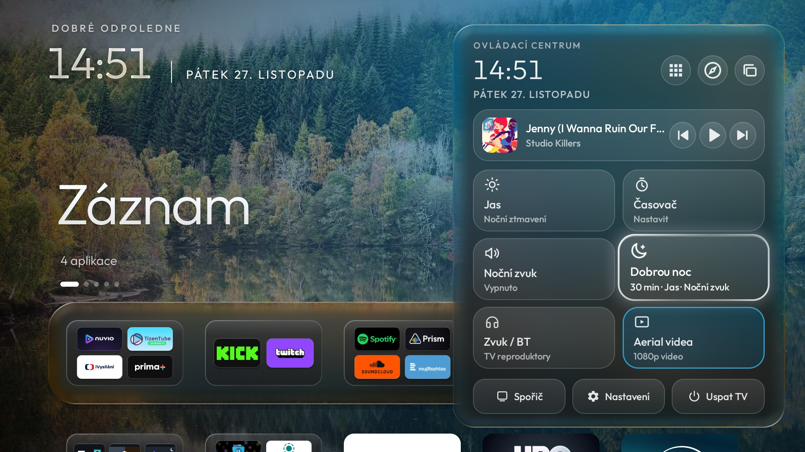
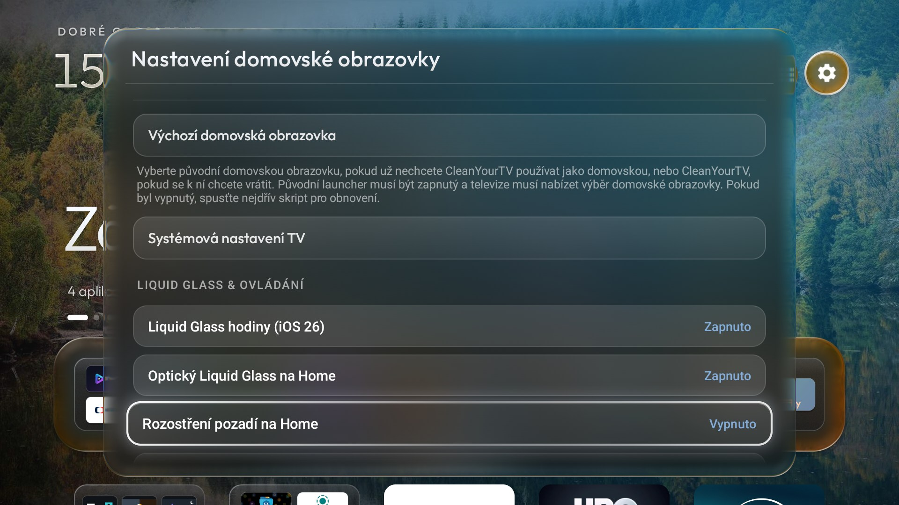
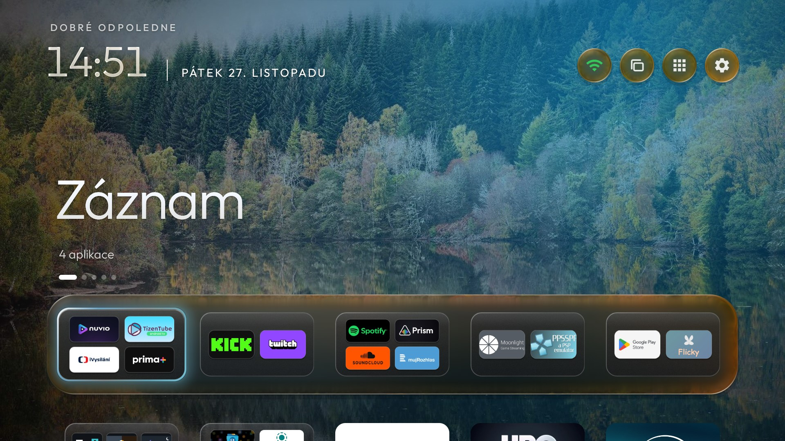
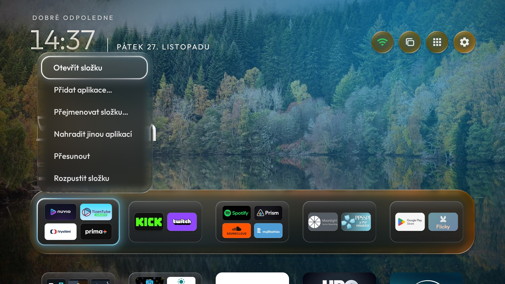

# Matcher — Uživatelský návod pro Android TV / Google TV (CZ)

Tato příručka shrnuje ovládání, nové funkce, úpravy vzhledu i bezpečný návrat do původního stavu pro launcher **Matcher** (postavený na [CleanYourTV](https://github.com/Gathin23/cleanyourtv) s 3D optickým Liquid Glass a 8 lokalizovanými modulárními doplňky).

> 📸 **[Kompletní fotogalerie release `v1.1.2` (4 nové snímky režimu ostrého Home + 43 snímků `v1.1.1` všech obrazovek, menu a doplňků) → `GALLERY.md`](GALLERY.md)**

| Nově v `v1.1.2` — Ovládací centrum nad ostrým Home | Nově v `v1.1.2` — Přepínač *Rozostření pozadí na Home* |
|---|---|
|  |  |

| Domovská obrazovka (`v1.1.2` ostré hrany Docku a pilulek) | Kontextové menu dlaždice nad 100% ostrým Home |
|---|---|
|  |  |

---

## 1. Ovládání dálkovým ovladačem (tříúrovňové mapování)

Výchozí mapa pro **Xiaomi TV Box S 3rd Gen** (upravíš v [`my-theme/config.json`](../my-theme/config.json) pod `app_keys`; kromě krátkého stisku a podržení `hold:` lze k libovolnému tlačítku přidat i dvojklik `double:` — tlačítka bez `double:` reagují okamžitě bez zpoždění):

| Tlačítko na ovladači | Krátký stisk (Tap) | Podržení ~0,5 s (`hold:`) |
|---|---|---|
| **Domů** (`HOME`) | Domovská obrazovka Matcher | **Ovládací centrum** (funguje i přes spuštěné aplikace!) |
| **Zpět** (`BACK`) | Zpět (na ploše otevře Spořič) | **Nedávné aplikace** (přepínač aplikací přes cokoliv) |
| **Aplikace** (`ALL_APPS`) | **Knihovna aplikací** (přes cokoliv) | **Ambient spořič / Aerial video** |
| **Netflix** | **Nuvio** | **Netflix** |
| **YouTube** | **TizenTube Cobalt** | **Spotify** |
| **Prime Video** | **Oneplay** | **Rychlá lišta Jasu / nočního filtru** |
| **Xiaomi TV+** | **Magenta TV** | **Rychlá lišta Časovače spánku** |
| **Mikrofon** | **Google Assistant** (nativně) | — |

> **Hraní her (Moonlight apod.):** Funkce `gamepad_passthrough` automaticky propouští vstupy z připojeného herního ovladače přímo do hry bez zásahu launcheru.

---

## 2. Hlavní funkce na TV

### Vzhled, 6 stylů skla, Liquid Glass 2.0 a 60 FPS engine (`v1.2.0` + `v1.2.1`)
- **6 předvoleb materiálu skla (`GlassStyle`):** Přímo v *Nastavení launcheru → Styl skla* lze živě přepínat mezi **Matné tónované**, **Čistá černá (OLED)**, **Mléčná bílá** (plná inverze do světlého skla s tmavým grafitovým textem, ikonami a tmavým Fresnel focus ringem), **Čiré sklo**, **Barevný nádech (Material You)** a **Automaticky (Den / Noc)** — synchronizovaně pro Home, Dock, horní pilulky, všechny modály i všech 8 doplňků (`GlassKit`).
- **4vrstvý optický Liquid Glass 2.0 & 60 FPS Dock:** Dock běží ve 100% hardwarové GPU cache (`LAYER_TYPE_HARDWARE` VRAM, **0,00 % jank** na 2 GB RAM boxu) s oddělenou barevnou vrstvou `DockTintOverlayView` pro sametové `420 ms` barevné přechody pod složkami i aplikacemi, živým laděním **Krytí pruhu docku (30–100 %)** napříč všemi 6 styly skla, samostatným přepínačem **Barevná záře za dockem** a čistým ořezem + fade-outem při scrollování. Každá vrstva opticky láme přesně to, co je pod ní (nad cizími streamovacími aplikacemi se automaticky přepíná čistý frosted režim bez úniku tapety).
- **Režim 100% ostrého Home, Rozostření vnořených menu a globální Optika tekutého skla:**
  - Přepínač **Rozostření pozadí na Home** vypne celoobrazovkový blur za okny (plocha venku zůstane 100% ostrá bez ztmavení) a nezávislý přepínač **Rozostření vnořených menu** umožní ponechat 100% ostré i rodičovské okno za kontextovými nabídkami.
  - Plovoucí okna, kontextová menu i doplňky si automaticky vykreslí vlastní mléčný rozostřený vnitřek cachovaný v GPU `RenderNode` (plynulých 60 FPS, bez nežádoucí průhlednosti) s ostrými `960×540` / `640×360` optickými okraji.
  - Přepínač **Optika tekutého skla** nyní platí jednotně pro celý launcher, všech 8 doplňků i plovoucí rychlé lišty *Jasu* a *Časovače spánku*.
- **Náhodné webové tapety (`picsum.photos`), 3stupňové plynulé přenačítání a 16 rozvržení mřížky:**
  - V *Nastavení launcheru → Tapeta* (nebo jedním klikem v QR web editoru z mobilu) vybereš **Náhodnou fotku z webu (Picsum)** (`1920×1080` CC0/Unsplash, automatická hodinová rotace + offline cache); přepnutí na *Bez tapety* okamžitě čistí starý lom na hranách Docku i pilulek.
  - Změny tapet a nastavení se aplikují okamžitě na místě bez černého probliknutí (Tier 1), změny mřížky se plynule prolnou se zachováním fokusu (Tier 2), všech **16 kombinací (`4–7 sloupců × 0–3 řádky pod dockem`)** sedí na 1080p bez ořezu a **Karty modulů** čistě skrývají ikony jak na Home, tak v Knihovně aplikací.
- **3D naklánění dlaždic, 4K HEVC Aerial spořič a sezónní tapety:** Dlaždice reagují 3D pružinovým náklonem a světelným odleskem (`TileSheenDrawable`), Apple TV 4K HEVC Aerial videa podporují připínání oblíbených scén (`★`), místní počasí a OLED ochranu, plus dynamické tapety (`wallpaper_moods`) a volitelné **3D skleněné hodiny (iOS 26)**.

### Učení tlačítek ovladače na TV, QR editor & OTA aktualizace (`v1.2.0` + `v1.2.1`)
- **Učení tlačítek přímo na TV (bez PC a ADB):** V *Nastavení launcheru → Tlačítka ovladače → Naučit tlačítko* stačí stisknout libovolnou zkratku na ovladači a přiřadit jí nezávisle **Krátký stisk**, **Dvojklik** i **Podržení (0,5 s)**.
- **Rozšířený QR web editor z mobilu:** Kromě klíčů pro TMDB / Trakt / Plex / Home Assistant / Immich umožňuje z telefonu spravovat tlačítka ovladače (s rozbalovacím seznamem nainstalovaných aplikací), vlastní názvy a skrytí aplikací, město/souřadnice počasí, nahrát tapetu přímo z galerie telefonu, zapnout Picsum a exportovat/importovat `config.json`.
- **OTA aktualizace přímo na TV a rychlé skripty z PC:** U podepsaných GitHub Release APK (`v1.2.0+`) lze aktualizovat launcher i všech 8 doplňků přímo v *Nastavení launcheru → Aktualizace (GitHub)* (včetně automatického znovupřipojení služeb Přístupnosti po aktualizaci na Androidu 14) nebo jedním příkazem přes `update.ps1` / `update.sh` bez instalace JDK/SDK (viz [`UPDATE.md`](../UPDATE.md)).

### Složky, Knihovna aplikací a Media Mini-Player
- **Složky:** Podrž **OK** na libovolné aplikaci → *Přidat do složky* → *Nová složka*. Uvnitř složky lze kdykoliv přidávat další aplikace (*+ Přidat*), přejmenovat ji, přesouvat dlaždice nebo ji rozpustit.
- **Přesun a skrytí dlaždic:** Podrž **OK** na libovolné dlaždici → *Přesunout* nebo *Odebrat z domovské obrazovky* (aplikace zůstane dostupná v Knihovně aplikací).
- **Media Mini-Player:** Při přehrávání hudby/videa se v horní liště objeví otáčející se vinylová deska — kliknutím otevřeš kompaktní přehrávač s přepínáním zdrojů a posuvníkem času.

### Objevovat (*Discover*), Chytrá domácnost & Nastavení přes QR z mobilu
- **Objevovat** *(ikona kompasu v horní části Ovládacího centra)*:
  - **Pokračovat ve sledování (*Watch Next*)** s možností povolení oprávnění `READ_TV_LISTINGS` jedním kliknutím přes lokální ADB.
  - **Nesponzorované tipy** (TMDB / Trakt / Plex) filtrované na tvé nainstalované aplikace, včetně přímého otevírání v Nuvio.
- **Nastavení z mobilu přes QR kód** *(Nastavení → Nastavit z mobilu (QR) nebo tlačítko QR v Objevovat)*:
  - Zobrazí QR kód na dočasný lokální web na TV — z telefonu pohodlně zadáš API klíče a adresy pro **TMDB, Trakt, Plex, Home Assistant i Immich**. Po zavření dialogu se server okamžitě vypne.
- **Chytrá domácnost a živé kamery PiP (Home Assistant):** Po zadání adresy, tokenu a entit přes QR se přímo v Ovládacím centru objeví přepínače světel, zásuvek, scén i **živý plovoucí náhled kamer (`camera.*`)** přes jakoukoliv aplikaci.
- **Fotky z Immich:** Periodická synchronizace vybraného alba z vlastního Immich serveru.

### Zvuky, Air-Mouse a Ochrana proti pádu
- **Jemné UI zvuky kliknutí** a **podpora myši / Air-Mouse** na všech obrazovkách i vyskakovacích oknech.
- **Crash Watchdog** hlídá opakované pády launcheru a umí bezpečně přepnout zpět na výchozí systémový launcher.
- **Bezpečný návrat na původní Google TV** přímo z TV (*Nastavení → Obnovit původní Google TV launcher (ADB)*).

---

## 3. Modulární doplňky (8 výchozích + 40+ dalších v upstreamu)

Výchozí sada 8 doplňků má **100% přeložené rozhraní ve všech 31 jazycích** (včetně češtiny, slovenštiny, polštiny a angličtiny — v `v1.2.1` doplněny i všechny zbývající texty pro *Jas*, *Noční zvuk* a *Bluetooth připojení*) a sdílí [`GlassKit.java`](../patches/addons/brightness/app/src/main/java/io/github/maxhayim/brightness/GlassKit.java) (Liquid Glass 2.0 + 6 stylů skla + Material 3 Expressive blur + přepínač optiky a rozostření vnořených menu + živý focus ring):

1. **Jas (`Brightness`)** — ztlumení pod minimum TV + teplý noční filtr + rychlá lišta.
2. **Časovač spánku (`Sleep Timer`)** — uspání za 15–120 min, týdenní rozvrh a výjimky, HDMI-CEC + rychlá lišta.
3. **Sluchátka (`Headphones`)** — stav baterie a automatická pauza + ztlumení TV při odpojení sluchátek.
4. **Bluetooth připojení (`Bluetooth Connect`)** — rychlé připojení/odpojení spárovaných BT zařízení.
5. **Noční zvuk (`Quiet Hours`)** — noční strop hlasitosti.
6. **Počasí (`Weather`)** — 3denní předpověď a kvalita ovzduší (Open-Meteo).
7. **Světový čas (`World Clock`)** — až 6 světových měst + volitelný spořič.
8. **Kapacita a paměť (`Capacity Stats`)** — živý přehled RAM a úložiště.

> **Libovolné přidávání a odebírání doplňků:** Doplňky jsou 100% volitelné. Můžeš instalaci add-onů přeskočit parametrem `-SkipAddons`, nepotřebné karty skrýt v *Nastavení → Karty modulů* či odinstalovat, nebo si vybrat **kterýkoliv ze 40+ doplňků v upstreamu** ([`Gathin23/cleanyourtv/tree/main/addons`](https://github.com/Gathin23/cleanyourtv/tree/main/addons) — např. `ad-blocking` pro Pi-hole/AdGuard Home, `tv-hub` pro IPTV/M3U, `frigate-glance`, `game-day`, `remote-access`, `scoreboard`, `files-card`, `floating-clock`, `winter-cabin`, `koi-pond`, `neon-dream` aj.). Nově přidané doplňky lze pomocí `GlassKit.java` snadno vizuálně sladit s Liquid Glass 2.0 vzhledem Matcheru (přesný postup pro lidi i AI agenty je v [`SKILL.md`](../SKILL.md#playbook-4--adding-visually-matching-glasskit-or-removing-modular-add-ons)).

---

## 4. Kde najít zbytek zdrojového kódu a jak začít na vlastní TV / boxu

Matcher funguje jako **overlay sada patchů** nad upstream projektem [**`Gathin23/cleanyourtv`**](https://github.com/Gathin23/cleanyourtv) (ověřeno na CleanYourTV 3.6+, commit [`be60870`](https://github.com/Gathin23/cleanyourtv/commit/be6087056a1c7d4f08f3f1cc778d92374d86ef27)). Proto jsou ve složce `patches/` jen naše nové a upravené soubory — samotný Gradle projekt, základ launcheru, zdrojáky add-onů, 33+ témat a profily pro 504+ TV jsou v upstreamu a [`apply-setup.ps1`](../apply-setup.ps1) si ověřený commit stáhne automaticky.

| Co hledáš | Kde to najdeš |
|---|---|
| **Základní projekt launcheru + Gradle** | [`Gathin23/cleanyourtv/tree/main/launcher`](https://github.com/Gathin23/cleanyourtv/tree/main/launcher) |
| **Zdrojové kódy všech 40+ add-onů** | [`Gathin23/cleanyourtv/tree/main/addons`](https://github.com/Gathin23/cleanyourtv/tree/main/addons) |
| **33+ hotových témat** | [`Gathin23/cleanyourtv/tree/main/themes`](https://github.com/Gathin23/cleanyourtv/tree/main/themes) |
| **Databáze 504+ modelů TV / boxů** | [`Gathin23/cleanyourtv/tree/main/docs/devices`](https://github.com/Gathin23/cleanyourtv/tree/main/docs/devices) a [`examples/`](https://github.com/Gathin23/cleanyourtv/tree/main/examples) |
| **Návod na mapování tlačítek ovladače** | [`Gathin23/cleanyourtv/blob/main/docs/REMOTE.md`](https://github.com/Gathin23/cleanyourtv/blob/main/docs/REMOTE.md) |
| **Bezpečnostní pravidla & přepínače** | [`DOS-AND-DONTS.md`](https://github.com/Gathin23/cleanyourtv/blob/main/docs/DOS-AND-DONTS.md) a [`switches.md`](https://github.com/Gathin23/cleanyourtv/blob/main/docs/switches.md) |

### Postup pro novou TV / box
Matcher je otestovaný primárně na **Xiaomi TV Box S 3rd Gen** (`MiTV-AFMU0`, Android 14). **Každý výrobce TV má vlastní specifika** (u integrovaných TV jako Sony, TCL, Philips nebo Hisense bývají na systémové balíčky navázané HDMI vstupy, obrazové režimy nebo tuner; některé Xiaomi/Oppo firmware navíc hlídají povolené `applicationId` pro HOME).

1. **Zapni ADB ladění na TV a naklonuj Matcher na PC:**
   - Na TV: **Nastavení → Systém → O zařízení → Číslo sestavení Android TV OS** (klikni **7× OK**) → **Možnosti pro vývojáře** → zapni **Ladění USB** (případně **Bezdrátové ladění** na Androidu 14).
   - Na PC:
     ```powershell
     git clone https://github.com/ryslavy/matcher.git
     cd matcher
     ```
2. **Zjisti přesný model své TV / boxu a verzi Androidu:**
   ```powershell
   adb shell getprop ro.product.manufacturer
   adb shell getprop ro.product.model
   adb shell getprop ro.build.version.sdk
   ```
3. **Zkontroluj profil svého modelu v upstream databázi CleanYourTV** (`docs/devices/` a `DOS-AND-DONTS.md`, po spuštění skriptu i lokálně v `./cleanyourtv/docs/devices/`).
4. **Nikdy nespouštěj `my-debloat.txt` na jiném než `MiTV-AFMU0` zařízení** — pro všechny ostatní TV/boxy použij parametr `-SkipDebloat` a před zásahem si ulož seznam zapnutých balíčků (`adb shell pm list packages -e > backup\enabled.txt`).
5. **Kompatibilita podle verze Androidu a GPU:**
   * **Android 13/14+ (`SDK 33+`):** plný 3D AGSL Liquid Glass 2.0 + hardwarový Material 3 Expressive blur.
   * **Android 8–12 (`SDK 26–32`):** automatický čistý fallback bez AGSL shaderu, vše ostatní funguje stejně.
   * **Slabší GPU / 1–1,5 GB RAM TV (např. MediaTek MT5895):** v `my-theme/config.json` zapni `"reduced_motion": true` a `"glow_snap": true` a v Nastavení vypni *Liquid Glass* optiku.

---

## 5. Vypínání vizuálních prvků a rychlé příkazy z PC

Většinu efektů lze snadno vypnout nebo upravit i bez znalosti kódu (nebo o to požádat svého AI agenta — repozitář obsahuje `AGENTS.md` a `SKILL.md`):
* **Přímo v TV (*Ovládací centrum → Nastavení → Nastavení launcheru*):** Styl skla (6 předvoleb), Krytí pruhu docku (30–100 %), Barevná záře za dockem, 3D Liquid Glass hodiny, **Optika tekutého skla** (globálně pro launcher i doplňky), **Rozostření pozadí na Home**, **Rozostření vnořených menu**, Náhodná webová tapeta (Picsum), Tlačítka ovladače (*Naučit tlačítko*), Zvuky kliknutí, OLED ochrana spořiče, Aerial videa, region Objevovat, Znovu načíst launcher a OTA Aktualizace (GitHub).
* **V [`my-theme/config.json`](../my-theme/config.json) (bez kompilace):** `dock_glass`, `dock_opacity`, `cinematic_home`, `ambient_glow`, `app_glow`, `reduced_motion`, `glow_snap`, `columns`, `dock_apps`, `app_labels`, `app_keys`, vlastní tapety v `my-theme/wallpapers/`.
* **Vlastní výběr doplňků:** nepotřebné doplňky můžeš kdykoliv odebrat nebo naopak přidat kterýkoliv ze 40+ doplňků z `cleanyourtv/addons/` a nechat AI agenta sladit jeho vzhled přes `GlassKit.java` (postup v [`SKILL.md`](../SKILL.md#playbook-4--adding-visually-matching-glasskit-or-removing-modular-add-ons)).
* **Vlastní město pro počasí/slunce:** uprav `latitude`, `longitude`, `weather_city` v [`patches/launcher-config.xml`](../patches/launcher-config.xml) (výchozí `Prague`) před buildem.

> **Důležité před prvním nasazením s debloatem na Android 14:** Na TV v **Nastavení → Síť a internet** nejdříve svou Wi-Fi **Zapomeň** a znovu se k ní připoj, aby síť nevlastnil `setupwraith`.
>
> **Bezdrátové ladění (Android 14) a macOS/Linux:** Pro Bezdrátové ladění nejprve spáruj TV přes `adb pair <IP>:<PAIR_PORT>` a pak předej aktivní port jako `-TvHost <IP>:<PORT>`. Na macOS/Linuxu fungují stejné kroky z `apply-setup.ps1` nativně přes JDK 17, `./gradlew` a `adb`.

```powershell
# Bezpečné nasazení na jakýkoliv Android TV / Google TV box (bez Xiaomi debloatu):
powershell -ExecutionPolicy Bypass -File .\apply-setup.ps1 -TvHost <TV_IP> -SkipDebloat

# Kompletní nasazení včetně debloatu (jen Xiaomi TV Box S 3rd Gen / MiTV-AFMU0):
powershell -ExecutionPolicy Bypass -File .\apply-setup.ps1 -TvHost <TV_IP>

# Nahrání úprav v my-theme\config.json (vlastní appky, ovladač, vizuální přepínače):
.\switch-theme.ps1 my-theme -TvHost <TV_IP>

# Vyzkoušení jiného z 30+ témat (zachová dock, názvy i tlačítka):
.\switch-theme.ps1 -List
.\switch-theme.ps1 aurora -TvHost <TV_IP>

# Rychlá binární aktualizace již nainstalovaného podepsaného Matcheru (bez JDK/SDK):
powershell -ExecutionPolicy Bypass -File .\update.ps1 -TvHost <TV_IP>

# Kompletní návrat do původního stavu:
powershell -ExecutionPolicy Bypass -File .\restore-all.ps1 -TvHost <TV_IP>
```

Po dokončení úprav počkej **15 sekund** před restartem TV boxu a vypni síťové ADB ladění v *Možnostech pro vývojáře*, pokud ho už nepotřebuješ.
